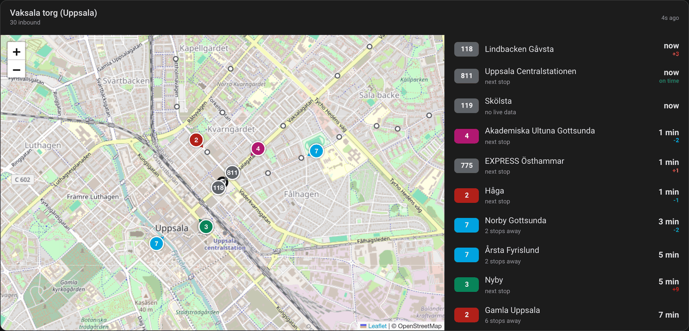
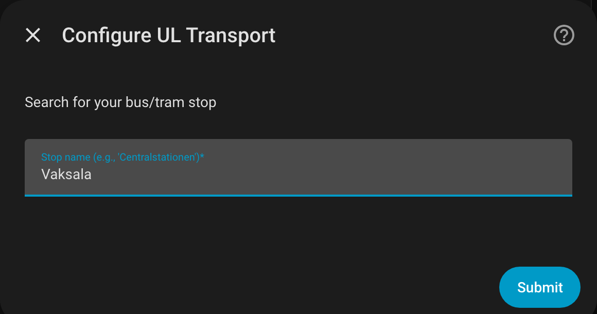
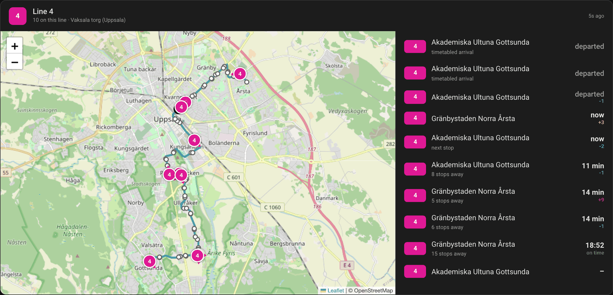
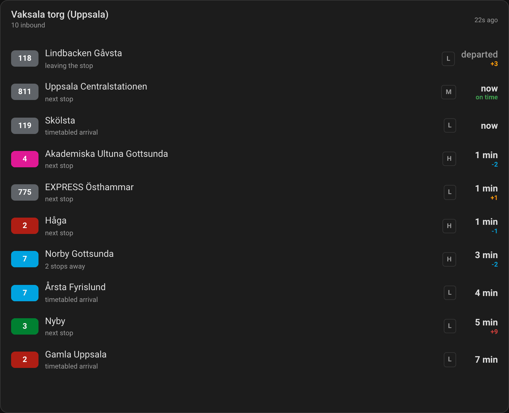

# UL Transport for Home Assistant

[](https://hacs.xyz/)
[](https://github.com/AlexanderBabel/ul-transport/releases)
[](https://github.com/AlexanderBabel/ul-transport/actions/workflows/validate.yml)
[](LICENSE)

Real-time departures for **UL (Upplands Lokaltrafik)** in Uppsala län, in Home
Assistant. Get a "next bus in 4 minutes" sensor for any stop, a live map of the
buses actually heading your way, and a voice answer when you ask.



## What you get

| | |
| --- | --- |
| 🚌 **A sensor per stop and line** | Its state is a plain number of minutes, so `numeric_state` triggers work with no templating |
| 🗺️ **A live map card** | Real vehicle positions, arrival times and how many stops away each bus is |
| 🕑 **A departure board** | The same card as a list, cheap enough to leave on a wall panel all day |
| 🗣️ **A voice answer** | "When does the next bus go?" — answered by your Assist agent |
| 🔍 **Setup in the UI** | Search for your stop by name; no YAML, no stop ids to look up |
| 🇸🇪 **English and Swedish** | Both fully translated |

The departure sensors work on their own. The live map is optional and needs two
free API keys — see [Live map card](#live-map-card).

## Requirements

- Home Assistant **2025.2** or newer
- A stop served by UL (Uppsala county)
- For the live map only: a free [Trafiklab](https://www.trafiklab.se/) account

## Installation

### HACS

1. HACS → three-dot menu → **Custom repositories**
2. Add `https://github.com/AlexanderBabel/ul-transport` with category
   **Integration**
3. Search for **UL Transport**, install it, and restart Home Assistant

### Manually

Copy `custom_components/ul_transport` into your Home Assistant `config/custom_components`
directory and restart.

## Set up your first stop

1. **Settings → Devices & Services → + Add Integration**
2. Search for **UL Transport**
3. Type part of your stop's name — "Centralstationen", "Gränby", whatever you
   would say out loud
4. Pick your stop from the results
5. Choose which lines to follow. **Leave it empty for all of them**, which also
   covers lines that only run at other times of day
6. Set how often to refresh (default 60 s, range 30–600 s)



Repeat for as many stops as you like — each becomes its own device. To change
anything later, press **Configure** on the integration.

## Entities

Each stop is a device, and its entities are grouped under it. Rename the device
and the entity names follow.

| Entity | What its state is |
| --- | --- |
| `sensor.<stop>_next_departure` | Minutes until the next departure, whichever line |
| `sensor.<stop>_line_<line>_to_<direction>` | Minutes until that line's next departure |
| `sensor.<stop>_last_update` | When the board was last fetched (diagnostic) |
| `button.<stop>_refresh` | Fetches the board by hand |

Attributes on the departure sensors: `line`, `direction`, `transport`,
`stop_name`, `departure` (real time where there is any, otherwise planned),
`scheduled_departure`, `delay_minutes` (positive is late, `null` when the bus
reports no real-time data at all), `is_realtime`, and `next_departures` /
`next_departures_in` for the four after it.

The state only moves when the board is polled, so it lags by up to your refresh
interval. For a countdown that ticks, use the map card.

### An automation

Because the state is a number of minutes, this is all it takes:

```yaml
automation:
  - alias: Nudge me before the bus
    triggers:
      - trigger: numeric_state
        entity_id: sensor.vaksala_torg_next_departure
        below: 6
    actions:
      - action: notify.mobile_app_phone
        data:
          message: >
            Line {{ state_attr('sensor.vaksala_torg_next_departure', 'line') }}
            to {{ state_attr('sensor.vaksala_torg_next_departure', 'direction') }}
            leaves in {{ states('sensor.vaksala_torg_next_departure') }} minutes.
```

## Live map card

The map shows the buses actually heading to your stop — where they are, when
they will arrive, and how many stops away they are. It creates no entities and
fetches only while a card is on screen, so nothing is polled when nobody is
looking and no vehicle data reaches your recorder.

### 1. Get two free Trafiklab keys

1. Register at [trafiklab.se](https://www.trafiklab.se/) and create a project
2. Add **two** datasets to it, and copy the key for each:
   - **GTFS Regional** — line names, stop names, route geometry
   - **GTFS Regional Realtime** — vehicle positions and arrival predictions
3. In Home Assistant, press **Configure** on any UL Transport stop and paste
   both keys

The keys are account-wide, so you enter them once. Every other stop then tells
you which stop holds them instead of asking again.

The first load downloads a ~26 MB timetable and builds an index — a few seconds
— then refreshes quietly every 6 hours.

### 2. Add the card

Open a dashboard, **+ Add card**, and pick **UL Transport Live Map**. It has a
live preview and a visual editor, so there is no YAML to write: choose the stop,
tick the lines you care about, and drag the radius slider until the map frames
what you want.

The YAML equivalent is two lines:

```yaml
type: custom:ul-transport-map
stop_id: 3700062
```

Clicking a bus, or an arrival row, switches to that line's route view:



### A cheap departure board

`content: list` drops the map and polls once every 90 seconds instead of every
5 — cheap enough to leave up on a wall panel all day. The countdowns still tick
down by the second in between, because the browser works them out from the
departure times.

```yaml
type: custom:ul-transport-map
stop_id: 3700062
content: list
list_minutes: 1440
list_count: 20
```



Past about forty minutes the realtime feed runs dry, so the list continues from
the timetable — `list_minutes: 1440` turns it into a board for the whole service
day at no extra request.

### Everything else

There are 20 card options — filtering by line or destination, layout, refresh
rate, how far ahead to look, animation, tap actions. All of them have a control
in the visual editor.

**→ [Full live map reference](docs/live-map.md)** — every option, what each row
means, how far behind reality the map is, and the API quota.

### Watch your quota

Trafiklab's free tier allows 30,000 realtime requests per 30 days. An open map
spends about a day's worth per hour, so it is for looking at rather than for
leaving up; the list card above fits comfortably inside the quota.

Two diagnostic sensors on a **Trafiklab API** device track exactly where you
stand:

| Entity | Limit |
| --- | --- |
| `sensor.trafiklab_api_realtime_requests_30_days` | 30,000 |
| `sensor.trafiklab_api_static_requests_30_days` | 60 |

They count over the same trailing 30 days the quota does, and survive restarts.
The integration stops calling out once the count is reached, so the card goes
stale rather than your key getting blocked. [More on the quota](docs/live-map.md#quota).

## Ask your voice assistant

The integration exposes **UL Transport departures** as an Assist LLM API, so a
conversation agent can answer out loud.

**Settings → Devices & Services →** your conversation agent **→ Configure**, then
tick *UL Transport departures* under the exposed APIs.

The agent gets one tool, `get_next_departures`, taking an optional stop and line.
Stop names are matched loosely, because speech-to-text gives "Vaksala torg" for a
stop configured as "Uppsala Vaksala torg".

If you use the [Voice Satellite card](https://github.com/jxlarrea/voice-satellite-card-integration)
(2026.8.10 or later), the answer brings the live map up on the satellite's screen
while it is read out. Nothing to configure on either side.

## Troubleshooting

**No stops found.** Try a shorter search term, and check the spelling — the
search matches UL's own names.

**A line I expected is missing.** Sensors are only created for lines running at
the moment the stop is set up. Leave the line selection empty to follow every
line, including ones that only run in the morning.

**"Custom element doesn't exist: ul-transport-map".** The card registers itself
as a dashboard resource, which browsers pick up the next time they open a
dashboard. A tab left open across an upgrade — usually a wall panel — needs one
hard reload. If it still does not appear, check that **Settings → Dashboards →
Resources** lists `/ul_transport/ul-transport-map.js`.

**The map never loads.** Both Trafiklab keys have to be set, and they have to be
for the two *different* datasets. Check
`sensor.trafiklab_api_static_requests_30_days` — if it is 0, the timetable was
never downloaded.

**Rate limit errors from UL.** Raise the refresh interval, and wait a few minutes
between configuration changes.

Still stuck? Download diagnostics from the integration's three-dot menu — they
include what UL is advertising versus what you selected, which is the usual
culprit — and open an [issue](https://github.com/AlexanderBabel/ul-transport/issues).
The keys are redacted.

## Removing it

Delete the stops from **Settings → Devices & Services**. The card's dashboard
resource is removed with the last stop. Then uninstall from HACS.

## Documentation

- [Full live map reference](docs/live-map.md) — card options, quota, limitations
- [Changelog](CHANGELOG.md)

## Contributing

Bug reports, ideas and pull requests are all welcome — this is a small
integration and easy to work on.

```bash
python -m venv venv && ./venv/bin/pip install -r requirements_test.txt
```

Run the checks the way CI does:

```bash
pytest
```

```bash
ruff check custom_components tests && ruff format --check custom_components tests
```

Every push also runs Home Assistant's own `hassfest` and HACS validation — see
[.github/workflows/validate.yml](.github/workflows/validate.yml).

A few things worth knowing before you start:

- **The card is shipped as plain JavaScript**, no build step. It has to parse on
  Home Assistant's legacy browser bundle, so no optional chaining and no nullish
  coalescing; `tests/test_card_asset.py` enforces this.
- **Comments explain *why*, not *what*.** Most of the surprising code is working
  around something real in UL's feeds, and the comment is the evidence for it.
- **Keep examples on a public hub.** Vaksala torg (`3700062`) and Uppsala
  Centralstation (`3700600`) are the ones used throughout; don't swap in a
  residential stop, in docs, tests or screenshots.
- New behaviour wants a test; `pytest --cov=custom_components/ul_transport
  --cov-report=term-missing` shows where the gaps are.

To run against a real instance, put the repo's `custom_components/ul_transport`
in a test config's `custom_components` directory and point Home Assistant at it.

## Credits

Built by [@AlexanderBabel](https://github.com/AlexanderBabel). Departure data by
[UL](https://www.ul.se/); vehicle positions and timetables via
[Trafiklab](https://www.trafiklab.se/) / Samtrafiken. Maps by
[OpenStreetMap](https://www.openstreetmap.org/copyright) contributors, drawn with
[Leaflet](https://leafletjs.com/).

Not affiliated with or endorsed by UL. MIT licensed — see [LICENSE](LICENSE).
